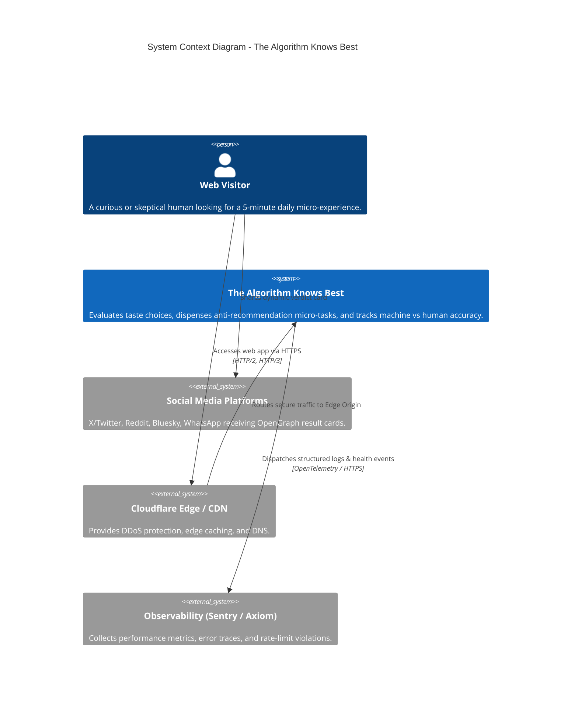
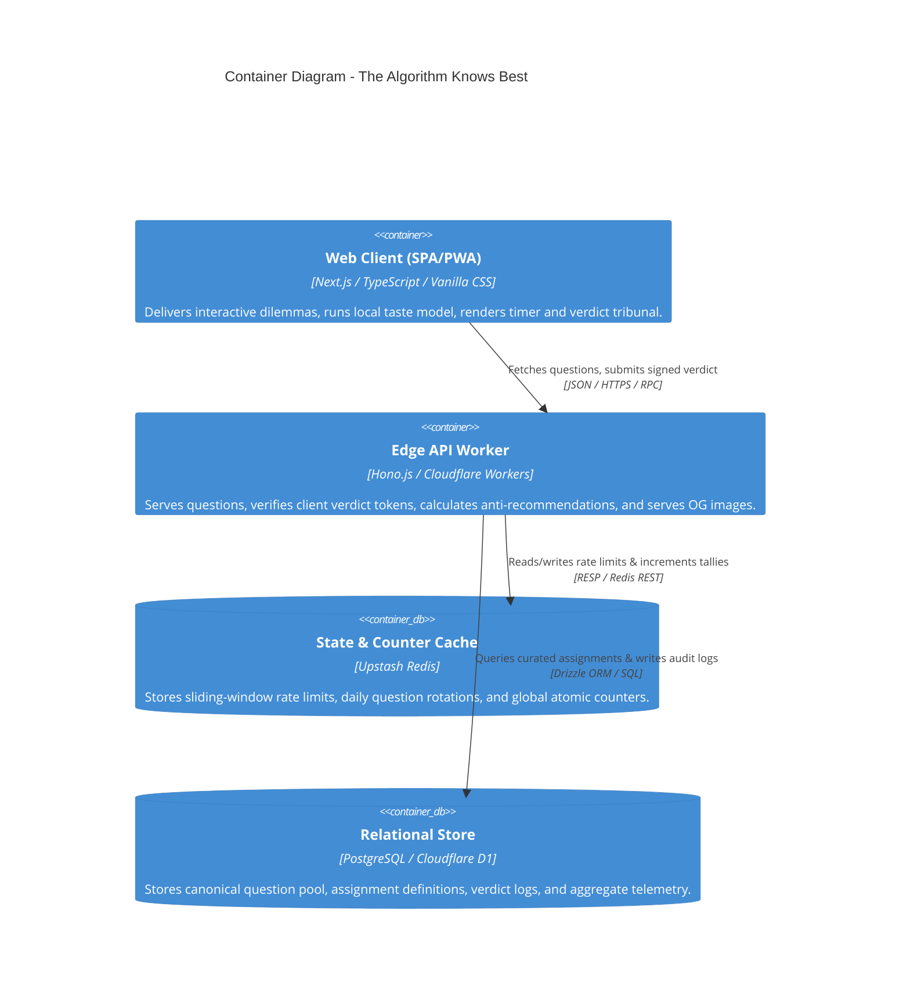

# System Architecture & Technical Strategy
**Project:** The Algorithm Knows Best  
**Document Version:** 1.0.0  
**Status:** Approved Architectural Blueprint  

---

## 1. Executive Summary & Product Vision

*The Algorithm Knows Best* is an asymmetrical human-versus-machine daily web experience. Unlike conventional recommendation engines (which maximize click-through rate, comfort, and engagement loops via echo chambers), *The Algorithm Knows Best* operates on an **anti-recommendation paradigm**:

> **Core Thesis:** The algorithm treats human taste as a solvable mathematical optimization problem that humans continuously botch. It exposes users to a curated "uncomfortable middle band" of experiences—tasks that are just outside their familiar comfort zone, sufficiently challenging to induce friction, yet close enough to potentially spark genuine appreciation.

The application must deliver an instant, zero-friction, zero-auth experience (playable in under 3 minutes with 0 setup), while maintaining enterprise-level resilience, data integrity, tamper-proof leaderboards, and sub-100ms global latency.

---

## 2. Architectural Principles & Quality Attributes

| Quality Attribute | Architectural Tactic | Engineering Target |
| :--- | :--- | :--- |
| **Zero Barrier to Entry** | Client-first anonymous UUID identity with hybrid sync; optional Passkey/OAuth upgrade. | 0 sign-up forms; First Interactive < 1.0s. |
| **Ultra-Low Latency** | Edge-rendered front-end, edge computation for vector matching, static asset pre-caching. | TTFB < 50ms globally; LCP < 1.2s; INP < 50ms. |
| **Deterministic Consistency** | Daily seed hashing based on `SHA256(UserSeed + DateUTC)`. | Identical daily question pair & candidate pool for replay resistance. |
| **Tamper Resistance** | HMAC-signed verdict tokens to prevent automated score manipulation and script kiddie leaderboard poisoning. | Zero unsigned verdict increments accepted by the telemetry layer. |
| **High Scalability** | Stateless edge compute, sharded atomic counters in Redis/KV, read-heavy caching. | Effortless scaling from 1,000 DAU to 1,000,000+ DAU at near-zero incremental compute cost. |
| **Content Safety** | Strict task quarantine, solo-first harmless constraints, zero social or physical hazard tasks. | 100% compliance with safety and harassment mitigation policies. |

---

## 3. Technology Stack Selection & Rationale

```
+-----------------------------------------------------------------------------------+
|                                  CLIENT LAYER                                     |
|  - Framework: Next.js 15 (React 19, App Router) or Lightweight Vite + React SPA  |
|  - Styling: Pure CSS Modules / Vanilla CSS Design Tokens (Custom Glassmorphism)   |
|  - State: Zustand (Client Store) + TanStack Query (Server State Synchronization)   |
|  - Motion: Framer Motion / Web Animations API (Subtle mechanical micro-delights) |
+-----------------------------------------------------------------------------------+
                                         │
                                         ▼ HTTPS / Edge Middleware (Routing, Rate Limiting)
+-----------------------------------------------------------------------------------+
|                                   EDGE & CDN                                      |
|  - Edge Network: Cloudflare Workers / Vercel Edge Network                         |
|  - Security: Cloudflare Turnstile (Invisible Bot Detection) + WAF Rate Limiting   |
|  - Media & OG Generation: @vercel/og / @cloudflare/pages OpenGraph generator     |
+-----------------------------------------------------------------------------------+
                                         │
                                         ▼ REST / RPC APIs
+-----------------------------------------------------------------------------------+
|                              APPLICATION SERVICES                                 |
|  - API Engine: Hono.js / Next.js Serverless Route Handlers (Edge Runtime)         |
|  - Vector Engine: In-Memory Cosine Distance Math Module (Pure TypeScript WASM)    |
|  - Signing & Crypto: Web Crypto API (SubtleCrypto HMAC-SHA256)                    |
+-----------------------------------------------------------------------------------+
                    │                                           │
                    ▼ Read/Write Data                           ▼ High-Speed State
+---------------------------------------------+   +---------------------------------+
|              PERSISTENCE TIER               |   |         FAST CACHE & TALLY      |
|  - Primary DB: PostgreSQL (Neon / Supabase) |   |  - Redis (Upstash Serverless)   |
|    or Cloudflare D1 (Distributed SQLite)    |   |  - Atomic Sharded Counters      |
|  - ORM / Query: Drizzle ORM (Zero-overhead) |   |  - IP-based Sliding Window      |
|  - Migrations: Automated GitOps Pipeline    |   |  - Rate-limit Buckets           |
+---------------------------------------------+   +---------------------------------+
```

### Detailed Rationale:
1. **Frontend (Next.js 15 / React 19 / TypeScript):**
   - Enables hybrid static generation (SSG) for static landing copy + client hydration for reactive multi-step dilemma cards.
   - Built-in edge OG card generation (`@vercel/og` or Satori) lets users share dynamically rendered sarcastic algorithm cards directly to Twitter/X, Bluesky, WhatsApp, and Reddit.
2. **API Framework (Hono.js on Edge):**
   - Negligible cold start (< 1ms on Cloudflare Workers / Edge runtimes).
   - Unified TypeScript types between backend routes and client queries via RPC.
3. **Database (PostgreSQL via Neon / Supabase or Cloudflare D1):**
   - High relational integrity for tasks, taste profiles, dilemma question pools, and verdict audit trails.
   - Serverless connection pooling (via PgBouncer or HTTP driver) handles sudden viral traffic spikes without connection starvation.
4. **Cache & Atomic Metrics (Upstash Redis):**
   - Global scoreboard (*"Algorithm Right: 142,391 | Humans Right: 12,402 | Disputed: 9,114"*) updated with atomic `HINCRBY` / distributed sharded counters.
   - Sliding-window rate-limiting to prevent tally spamming.
5. **Styling (Vanilla CSS Tokens / Modern CSS):**
   - Extreme visual fidelity: Dark neon brutalist / retro-futuristic terminal aesthetic.
   - High performance, zero CSS-in-JS runtime overhead.

---

## 4. C4 Model - Architecture Breakdown

### 4.1 Level 1: System Context Diagram



### 4.2 Level 2: Container Diagram



---

## 5. Subsystem Component Decomposition

The system is organized into five isolated, loosely coupled domains:

```
src/
├── app/                      # Web Client & Route Handlers
│   ├── api/
│   │   ├── daily/            # GET /api/daily - Question & candidate seed
│   │   ├── match/            # POST /api/match - Anti-recommendation computation
│   │   ├── verdict/          # POST /api/verdict - Signed verdict submission
│   │   ├── tally/            # GET /api/tally - Global & local score statistics
│   │   └── og/               # GET /api/og - Dynamic social result card generator
│   └── (game)/               # Game flows (Setup, Dilemmas, Task, Verdict, Score)
├── core/
│   ├── engine/               # Recommendation Math & Vector Distance Engine
│   │   ├── taste-vector.ts   # Vector transformation from binary choices
│   │   ├── distance.ts       # Cosine & weighted Euclidean distance
│   │   └── selector.ts       # Middle-band filtering & anti-repetition filter
│   ├── personality/          # Dialogue Engine & Persona Tone Matrix
│   │   ├── copy-matrix.ts    # Sarcastic replies categorized by outcome
│   │   └── speech-gen.ts     # Dynamic template interpolator
│   └── crypto/               # Integrity & Token Services
│       ├── verdict-token.ts  # HMAC-SHA256 issuance and validation
│       └── session.ts        # Client seed & anonymous signature generation
├── db/                       # Persistence Layer
│   ├── schema/               # Drizzle database tables
│   ├── migrations/           # Automated SQL migration scripts
│   └── seeds/                # Initial 30+ assignments & 15+ questions
└── services/                 # Infrastructure Integrations
    ├── cache.service.ts      # Redis cache & tally operations
    ├── limiter.service.ts    # Sliding window rate limiter
    └── telemetry.service.ts  # Logging & anomaly detection
```

---

## 6. Engineering Requirements Matrix

| Requirement ID | Category | Specification | Verification Method |
| :--- | :--- | :--- | :--- |
| **REQ-01** | Functional | User answers 4-5 binary dilemmas; system generates 1 micro-task in the 45th-75th percentile distance band. | Automated Vector Math Unit Tests (`vitest`). |
| **REQ-02** | Performance | Web application bundle size must not exceed 90 KB gzipped (excluding media). | Bundle Analyzer in CI Pipeline. |
| **REQ-03** | Reliability | Server failure or network partition falls back to client-side offline vector engine and localStorage tally. | Offline ServiceWorker & E2E network disconnection tests. |
| **REQ-04** | Security | Verdict submissions require valid HMAC nonce generated at assignment issue time, expiring in 15 minutes. | Automated replay & expired token penetration test. |
| **REQ-05** | Integrity | No rate limit bypass: A single client IP cannot submit more than 5 verdicts per 24-hour UTC window. | Distributed Redis sliding-window test suite. |
| **REQ-06** | Usability | Keyboard navigable (1/2 for choices, Enter for proceed, Esc to restart), WCAG 2.1 AA accessible. | Playwright accessibility testing with `axe-core`. |

---

## 7. Next Steps & Implementation Roadmap

1. **UML & Formal Modeling** (`Docs/02_UML_AND_SYSTEM_FLOWS.md`): Exact state transitions, sequence diagrams, and class contracts.
2. **Algorithm Engine Specification** (`Docs/03_MATHEMATICAL_ALGORITHM_SPEC.md`): Mathematical vector space definitions and distance band thresholds.
3. **Database Architecture** (`Docs/04_DATABASE_AND_DATA_MODEL.md`): Production SQL DDL, indexes, and caching topology.
4. **UX & Personality Bible** (`Docs/05_USER_INTERACTION_AND_UX.md`): Screen states, interaction mechanics, and character dialogue trees.
5. **Security, Privacy & Compliance** (`Docs/06_SECURITY_PRIVACY_AND_CONTENT_SAFETY.md`): Threat model and cryptographic verification.
6. **Scaling & Infrastructure** (`Docs/07_SCALING_AND_HIGH_AVAILABILITY.md`): 1K to 1M DAU capacity planning.
7. **DevOps & CI/CD** (`Docs/08_DEPLOYMENT_DEVOPS_AND_CI_CD.md`): Zero-downtime deployment pipelines and monitoring.
