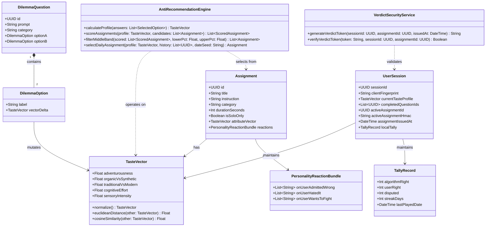
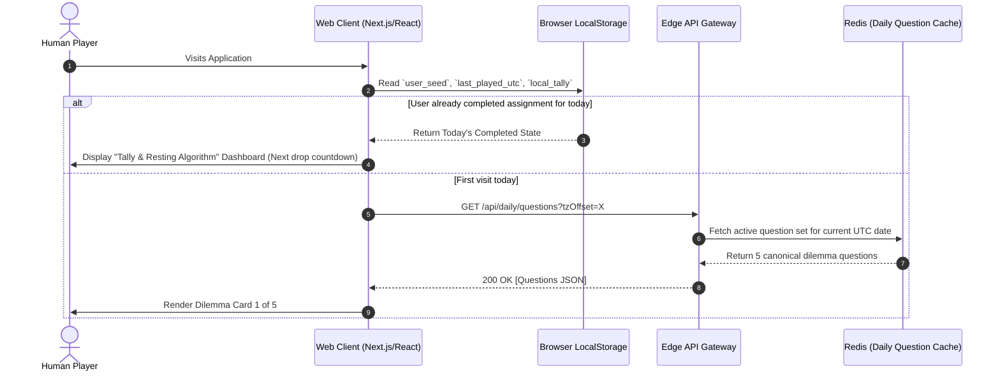
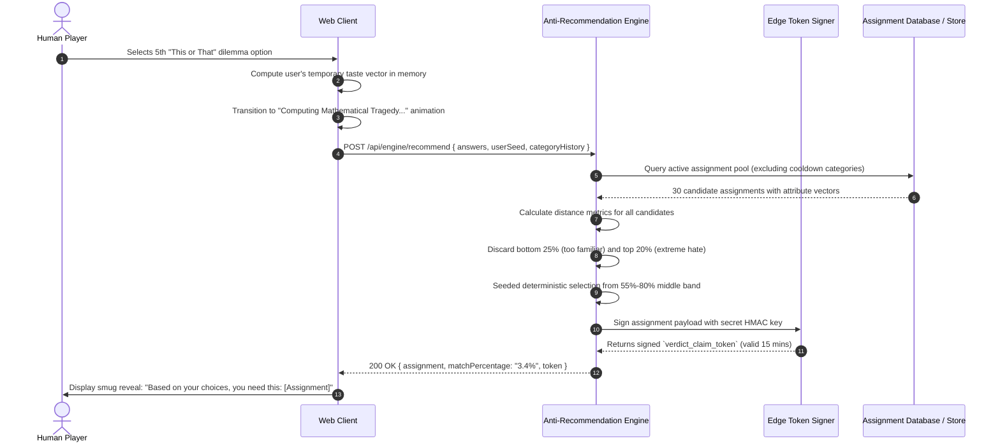
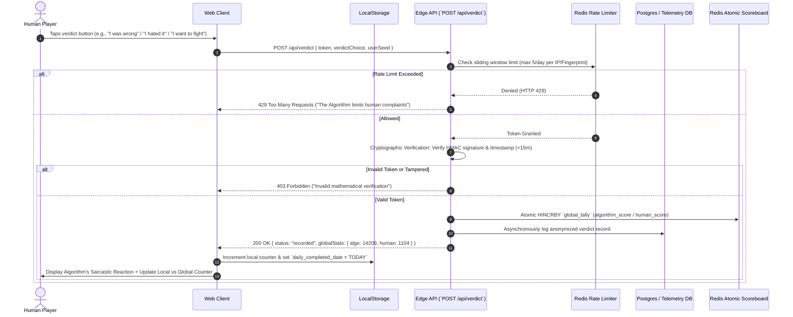
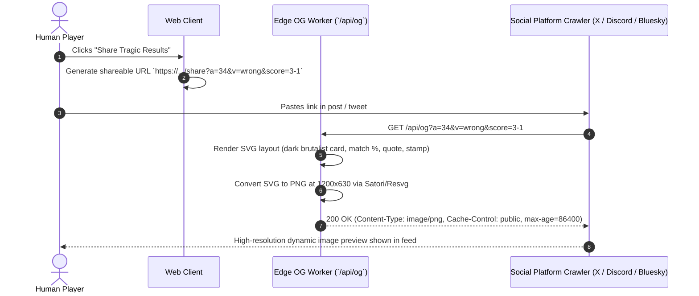
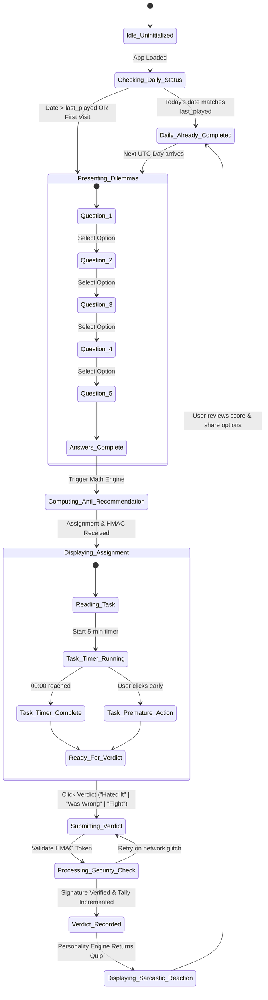

# UML & System Behavioral Models
**Project:** The Algorithm Knows Best  
**Document Version:** 1.0.0  
**Status:** Approved Engineering Specification  

---

## 1. Domain Class & Entity Model

The following Class Diagram specifies the core domain abstractions, value objects, and service contracts for the engine.



---

## 2. Sequence Diagrams

### 2.1 Daily Loop: Initialization & Dilemma Fetching



### 2.2 Recommendation Generation & Token Issuance



### 2.3 Verdict Submission & Tamper-Proof Tally Update



### 2.4 Dynamic Social Share Card Generation



---

## 3. State Machine Model

### 3.1 User Session State Transition Diagram



---

## 4. Activity Diagram: Anti-Recommendation Pipeline

```mermaid
flowchart TD
    Start([User Completes 5 Dilemmas]) --> VectorAccum[Accumulate 5D Taste Vector:<br>V = Sum(delta_i) / 5]
    VectorAccum --> FetchCandidates[Fetch Candidate Pool from DB/Store<br>Exclude category from yesterday]
    FetchCandidates --> DistanceLoop[Calculate Cosine & Euclidean Distances<br>D = 1 - CosineSimilarity(V, TaskVector)]
    
    DistanceLoop --> SortList[Sort Candidates by Distance Ascending]
    SortList --> TierSplit[Partition into 3 Tiers:<br>Tier 1: 0% to 35% Nearest<br>Tier 2: 36% to 75% Middle Band<br>Tier 3: 76% to 100% Extreme Outliers]
    
    TierSplit --> DropTier1[Drop Tier 1: Too Familiar / Boring]
    TierSplit --> DropTier3[Drop Tier 3: Known Hatred / Non-constructive]
    
    DropTier1 & DropTier3 --> RetainMiddle[Retain Tier 2: The Uncomfortable Middle Band]
    
    RetainMiddle --> SeededSelect{Multiple options in Tier 2?}
    SeededSelect -- Yes --> HashPick[Deterministic PRNG Selection:<br>Index = PRNG(UserSeed + Date) % Tier2.length]
    SeededSelect -- No --> FallbackPick[Take Nearest Available to 55th Percentile]
    
    HashPick --> PackageAssignment[Construct Assignment Payload]
    FallbackPick --> PackageAssignment
    
    PackageAssignment --> GenerateHmac[Sign with Server Secret:<br>Token = HMAC-SHA256(Payload + Expiry)]
    GenerateHmac --> ReturnPayload([Return Assignment + Token to Client])
```

---

## 5. Architectural Quality Checks for Models

- **Pure Functions:** Vector transformations and distance math are strictly stateless and deterministic.
- **Fail-Safe Fallbacks:** If the server API fails, the client uses an embedded bundle of 30 assignments and does vector filtering entirely inside the browser's JavaScript runtime.
- **Zero Race Conditions:** Score updates use Redis atomic operations (`HINCRBY`) rather than read-modify-write patterns, eliminating data corruption under viral traffic.
