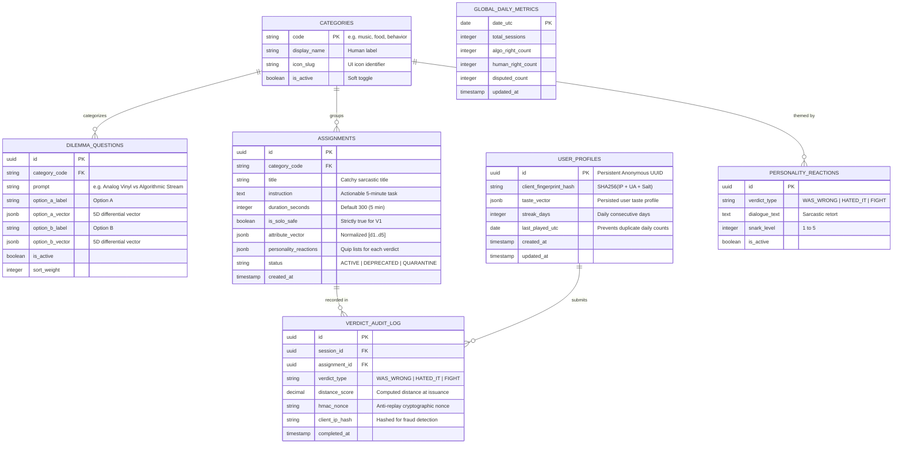

# Database Architecture & Data Model
**Project:** The Algorithm Knows Best  
**Document Version:** 1.0.0  
**Status:** Approved Data Architecture  

---

## 1. Relational Data Architecture (PostgreSQL & SQLite Compatible)

The storage design supports dual execution targets:
1. **Cloud PostgreSQL (Neon / Supabase)** for centralized, multi-region production with pgvector compatibility if needed in later phases.
2. **Cloudflare D1 / Embedded SQLite** for edge-native, zero-cold-start local query execution.

### 1.1 Entity-Relationship Diagram (ERD)



---

## 2. Production SQL DDL (PostgreSQL Schema)

```sql
-- ============================================================================
-- SCHEMA: THE ALGORITHM KNOWS BEST (PRODUCTION V1)
-- ============================================================================

CREATE EXTENSION IF NOT EXISTS "uuid-ossp";

-- 1. Categories Table
CREATE TABLE categories (
    code VARCHAR(32) PRIMARY KEY,
    display_name VARCHAR(64) NOT NULL,
    icon_slug VARCHAR(32) NOT NULL,
    is_active BOOLEAN NOT NULL DEFAULT TRUE,
    created_at TIMESTAMPTZ NOT NULL DEFAULT NOW()
);

-- 2. Dilemma Questions Table
CREATE TABLE dilemma_questions (
    id UUID PRIMARY KEY DEFAULT uuid_generate_v4(),
    category_code VARCHAR(32) NOT NULL REFERENCES categories(code) ON DELETE RESTRICT,
    prompt VARCHAR(255) NOT NULL,
    option_a_label VARCHAR(128) NOT NULL,
    option_a_vector JSONB NOT NULL, -- Format: { "adventurousness": 0.5, ... }
    option_b_label VARCHAR(128) NOT NULL,
    option_b_vector JSONB NOT NULL,
    is_active BOOLEAN NOT NULL DEFAULT TRUE,
    sort_weight INTEGER NOT NULL DEFAULT 100,
    created_at TIMESTAMPTZ NOT NULL DEFAULT NOW()
);

CREATE INDEX idx_dilemmas_active_weight ON dilemma_questions (is_active, sort_weight);

-- 3. Assignments Table
CREATE TABLE assignments (
    id UUID PRIMARY KEY DEFAULT uuid_generate_v4(),
    category_code VARCHAR(32) NOT NULL REFERENCES categories(code) ON DELETE RESTRICT,
    title VARCHAR(128) NOT NULL,
    instruction TEXT NOT NULL,
    duration_seconds INTEGER NOT NULL DEFAULT 300 CHECK (duration_seconds > 0 AND duration_seconds <= 900),
    is_solo_safe BOOLEAN NOT NULL DEFAULT TRUE,
    attribute_vector JSONB NOT NULL, -- 5D normalized vector
    personality_reactions JSONB NOT NULL, -- Sarcastic quip lists keyed by outcome
    status VARCHAR(16) NOT NULL DEFAULT 'ACTIVE' CHECK (status IN ('ACTIVE', 'DRAFT', 'QUARANTINE', 'DEPRECATED')),
    created_at TIMESTAMPTZ NOT NULL DEFAULT NOW(),
    updated_at TIMESTAMPTZ NOT NULL DEFAULT NOW()
);

CREATE INDEX idx_assignments_status_category ON assignments (status, category_code);

-- 4. User Profiles (Zero-PII Anonymous Sync)
CREATE TABLE user_profiles (
    id UUID PRIMARY KEY,
    client_fingerprint_hash VARCHAR(64) NOT NULL,
    taste_vector JSONB NOT NULL DEFAULT '{"adventurousness": 0, "sensoryIntensity": 0, "tradition": 0, "cognitiveEffort": 0, "absurdity": 0}',
    streak_days INTEGER NOT NULL DEFAULT 0,
    last_played_utc DATE,
    created_at TIMESTAMPTZ NOT NULL DEFAULT NOW(),
    updated_at TIMESTAMPTZ NOT NULL DEFAULT NOW()
);

CREATE INDEX idx_user_profiles_fingerprint ON user_profiles (client_fingerprint_hash);
CREATE INDEX idx_user_profiles_last_played ON user_profiles (last_played_utc);

-- 5. Verdict Audit Log (Tamper-Resistant Ledger)
CREATE TABLE verdict_audit_log (
    id UUID PRIMARY KEY DEFAULT uuid_generate_v4(),
    session_id UUID NOT NULL REFERENCES user_profiles(id) ON DELETE CASCADE,
    assignment_id UUID NOT NULL REFERENCES assignments(id) ON DELETE RESTRICT,
    verdict_type VARCHAR(16) NOT NULL CHECK (verdict_type IN ('WAS_WRONG', 'HATED_IT', 'FIGHT')),
    distance_score NUMERIC(5, 4) NOT NULL CHECK (distance_score >= 0.0 AND distance_score <= 1.0),
    hmac_nonce VARCHAR(64) NOT NULL UNIQUE, -- Prevents token replay attacks
    client_ip_hash VARCHAR(64) NOT NULL,
    completed_at TIMESTAMPTZ NOT NULL DEFAULT NOW()
);

CREATE INDEX idx_audit_session_completed ON verdict_audit_log (session_id, completed_at DESC);
CREATE INDEX idx_audit_ip_completed ON verdict_audit_log (client_ip_hash, completed_at DESC);

-- 6. Global Daily Metrics (Pre-aggregated Rollups)
CREATE TABLE global_daily_metrics (
    date_utc DATE PRIMARY KEY,
    total_sessions INTEGER NOT NULL DEFAULT 0,
    algo_right_count INTEGER NOT NULL DEFAULT 0,
    human_right_count INTEGER NOT NULL DEFAULT 0,
    disputed_count INTEGER NOT NULL DEFAULT 0,
    updated_at TIMESTAMPTZ NOT NULL DEFAULT NOW()
);
```

---

## 3. High-Speed State & Cache Topology (Redis Architecture)

To handle viral surges without querying PostgreSQL for transient states, Redis stores real-time counters, nonces, and rate limits.

### 3.1 Redis Key Specification

| Key Pattern | Redis Type | TTL | Purpose |
| :--- | :--- | :--- | :--- |
| `global:scoreboard` | Hash | Persistent | Master global tally (`algo_right`, `user_right`, `disputed`) |
| `daily:questions:{date_utc}` | String (JSON) | 48 hours | Cached 5-dilemma question set for the current UTC day |
| `assignment:pool:active` | String (JSON) | 6 hours | Cached list of all active assignments + vectors |
| `nonce:{token_hmac}` | String (`"1"`) | 900 sec (15m) | Nonce deduplication. If key exists, reject as replay attack |
| `ratelimit:ip:{ip_hash}:{hour}` | Integer | 3600 sec | Sliding counter (Max 15 requests/hour) |
| `ratelimit:verdict:{ip_hash}:{date}`| Integer | 86400 sec | Max 5 verdicts/day per IP |

### 3.2 Atomic Scoreboard Update (Lua Script)

To guarantee zero race conditions when thousands of users submit verdicts simultaneously:

```lua
-- KEYS[1] = 'global:scoreboard'
-- ARGV[1] = verdict_type ('WAS_WRONG' | 'HATED_IT' | 'FIGHT')

local field = 'disputed'
if ARGV[1] == 'WAS_WRONG' then
    field = 'algo_right'
elseif ARGV[1] == 'HATED_IT' then
    field = 'user_right'
elseif ARGV[1] == 'FIGHT' then
    field = 'disputed'
end

redis.call('HINCRBY', KEYS[1], field, 1)
redis.call('HINCRBY', KEYS[1], 'total', 1)

local scores = redis.call('HMGET', KEYS[1], 'algo_right', 'user_right', 'disputed')
return scores
```

---

## 4. Initial Seed Data Blueprint (30 Hand-Crafted Assignments)

The content pool features 30 curated assignments across 3 main categories:

```typescript
export const INITIAL_ASSIGNMENTS_SEED = [
  // MUSIC CATEGORY (10 items)
  {
    category: "music",
    title: "The Polka Penance",
    instruction: "You rejected high tempo and brass instruments. Listen to exactly 90 seconds of Frankie Yankovic polka at 70% volume. Count each accordion chord.",
    durationSeconds: 120,
    vector: { adventurousness: 0.7, sensoryIntensity: 0.9, tradition: -0.6, cognitiveEffort: -0.4, absurdity: 0.8 },
    reactions: {
      onUserAdmittedWrong: ["Unfortunate. Your soul clearly yearns for polka. The math warned you."],
      onUserHatedIt: ["As calculated. Your pedestrian ears remain entirely ordinary."],
      onUserWantsToFight: ["You cannot fight an accordion. It contains too much stored kinetic despair."]
    }
  },
  {
    category: "music",
    title: "10-Minute Harsh Noise Protocol",
    instruction: "Listen to 2 continuous minutes of Japanese Harsh Noise (Merzbow). Do not adjust EQ. Observe your nervous system entering combat mode.",
    durationSeconds: 150,
    vector: { adventurousness: 0.9, sensoryIntensity: 1.0, tradition: 0.9, cognitiveEffort: 0.3, absurdity: 0.9 },
    reactions: {
      onUserAdmittedWrong: ["You survived. You are now 4% more dangerous to society."],
      onUserHatedIt: ["Expected. True acoustic chaos requires superior cranial calibration."],
      onUserWantsToFight: ["The noise is already in your walls. Good luck."]
    }
  },
  // FOOD CATEGORY (10 items)
  {
    category: "food",
    title: "The Savory Peanut Butter Anomaly",
    instruction: "Spread 1 teaspoon of peanut butter onto a slice of sharp cheddar cheese. Eat it in one bite without grimacing.",
    durationSeconds: 180,
    vector: { adventurousness: 0.6, sensoryIntensity: 0.7, tradition: 0.4, cognitiveEffort: -0.2, absurdity: 0.6 },
    reactions: {
      onUserAdmittedWrong: ["Culinary heresy validated. Your palate has surrendered to logic."],
      onUserHatedIt: ["Your tastebuds cling desperately to childhood nostalgia."],
      onUserWantsToFight: ["Bring your complaints to the culinary tribunal. I will not listen."]
    }
  },
  // TINY BEHAVIOR CATEGORY (10 items)
  {
    category: "tiny_behavior",
    title: "The 3-Minute Dog Eulogy (For Cat People)",
    instruction: "You picked cats. Open a blank note and write a sincere, 150-word defense of Golden Retrievers as the apex companions of civilization.",
    durationSeconds: 240,
    vector: { adventurousness: 0.4, sensoryIntensity: -0.3, tradition: -0.5, cognitiveEffort: 0.8, absurdity: 0.7 },
    reactions: {
      onUserAdmittedWrong: ["Betrayal complete. Your feline has already filed for emancipation."],
      onUserHatedIt: ["Your stubborn allegiance to aloof predators is noted and pitied."],
      onUserWantsToFight: ["Direct your rage to the Golden Retrievers. They will forgive you anyway."]
    }
  }
];
```

---

## 5. Data Migration & Versioning Strategy

1. **Zero-Downtime Schema Evolution:**
   - Drizzle ORM migrations run during CI/CD before container or worker activation.
   - Expand-contract pattern for schema modifications: Add new nullable columns, backfill, make non-null in subsequent deploy.
2. **Deterministic Seeding:**
   - Seeds are idempotent (`ON CONFLICT (id) DO UPDATE`).
   - Assignment vectors and reactions can be reloaded without interrupting active user sessions.
