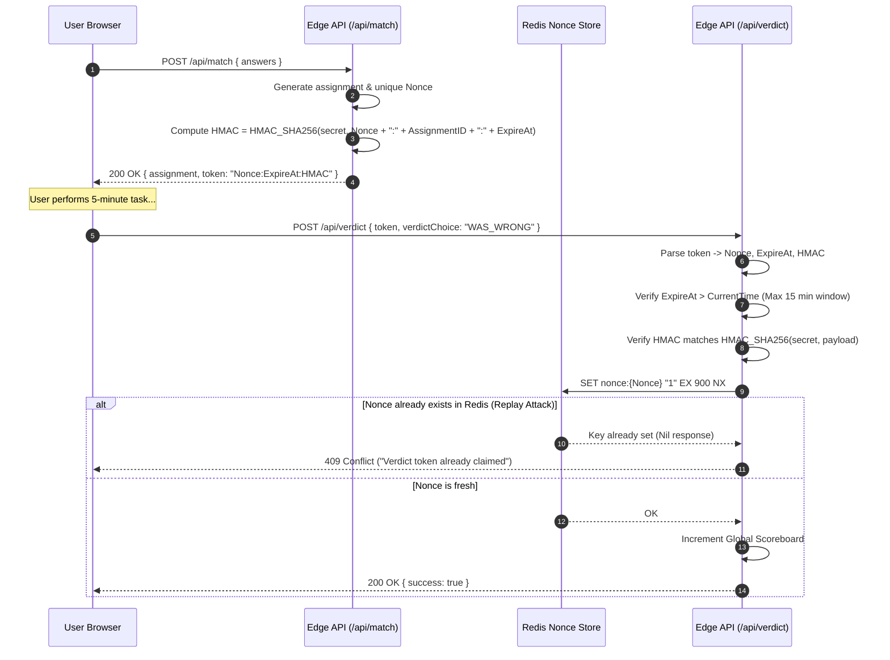

# Security, Privacy & Content Safety Specification
**Project:** The Algorithm Knows Best  
**Document Version:** 1.0.0  
**Status:** Approved Security Architecture  

---

## 1. Threat Modeling (STRIDE Analysis)

| Threat Category | Risk Scenario | Impact | Mitigation Strategy |
| :--- | :--- | :--- | :--- |
| **Spoofing** | Malicious actor impersonates legitimate user sessions or bot farms. | Skews global tallies, defaces scoreboard. | Cloudflare Turnstile (invisible bot verification) + daily rotating IP salt hashes. |
| **Tampering** | Attacker calls `POST /api/verdict` in a loop to inject 100,000 false "Human Won" scores. | Compromises game integrity and trust. | HMAC-SHA256 signed verdict claims + Redis single-use nonce validation (`NX`). |
| **Repudiation** | User disputes score tally or claims assignments were assigned maliciously. | Discredited algorithm logic. | Cryptographic audit trail in `verdict_audit_log` linking nonce, date, and task. |
| **Information Disclosure** | Leak of upcoming daily assignments, secrets, or internal quips. | Spoils daily experience. | Server-side vector calculation; candidate pools never exposed in bulk to client. |
| **Denial of Service** | DDoS against API endpoints during viral social media spikes. | Service degradation or downtime. | Edge CDN caching for static assets + Sliding-window rate limiting on API Workers. |
| **Elevation of Privilege** | Unprivileged client attempts to inject unvetted community assignments. | Injection of hazardous or NSFW micro-tasks. | Strict read-only API for public clients; admin endpoints gated behind Cloudflare Access / Zero Trust. |

---

## 2. Cryptographic Verdict Verification (Anti-Cheating Protocol)

To maintain true asymmetrical competition between Humans and The Algorithm, the global tally must be immune to automated scripted spam.

### 2.1 Cryptographic Flow Diagram



### 2.2 Token Signing Implementation (Web Crypto API)

```typescript
import { createHmac, timingSafeEqual } from "crypto";

export interface VerdictClaims {
  nonce: string;
  assignmentId: string;
  issuedAt: number;
  expiresAt: number;
}

export class VerdictSecurityService {
  private static readonly SECRET = process.env.HMAC_SECRET || "fallback-insecure-dev-secret";
  private static readonly TTL_MS = 15 * 60 * 1000; // 15 minutes

  /**
   * Generates a signed, tamper-evident verdict token
   */
  public static issueToken(assignmentId: string): string {
    const nonce = crypto.randomUUID();
    const issuedAt = Date.now();
    const expiresAt = issuedAt + this.TTL_MS;

    const payload = `${nonce}:${assignmentId}:${expiresAt}`;
    const hmac = createHmac("sha256", this.SECRET).update(payload).digest("hex");

    return `${payload}:${hmac}`;
  }

  /**
   * Cryptographically validates token integrity and expiry
   */
  public static verifyToken(token: string, assignmentId: string): { isValid: boolean; nonce: string } {
    const parts = token.split(":");
    if (parts.length !== 4) return { isValid: false, nonce: "" };

    const [nonce, tokenAssignmentId, expiresAtStr, receivedHmac] = parts;
    const expiresAt = parseInt(expiresAtStr, 10);

    // 1. Expiration check
    if (Date.now() > expiresAt) {
      return { isValid: false, nonce };
    }

    // 2. Assignment ID match check
    if (tokenAssignmentId !== assignmentId) {
      return { isValid: false, nonce };
    }

    // 3. Constant-time HMAC comparison
    const payload = `${nonce}:${tokenAssignmentId}:${expiresAtStr}`;
    const expectedHmac = createHmac("sha256", this.SECRET).update(payload).digest("hex");

    const isValid = timingSafeEqual(
      Buffer.from(receivedHmac, "hex"),
      Buffer.from(expectedHmac, "hex")
    );

    return { isValid, nonce };
  }
}
```

---

## 3. Rate Limiting & Bot Mitigation

1. **Edge WAF & Turnstile Bot Mitigation:**
   - Cloudflare Turnstile provides frictionless bot verification without frustrating CAPTCHAs.
   - Invisible token evaluated on verdict submissions if client behavior displays abnormal heuristics (e.g. < 3 seconds between assignment issue and verdict).
2. **IP Sliding Window Limits:**
   - `POST /api/match`: Max 10 requests / 10 minutes per IP.
   - `POST /api/verdict`: Max 5 successful submissions / 24 hours per IP.
   - Excessive violations result in a 429 response accompanied by an algorithmic quip:
     > *"You have exceeded your allotted human quota. The Algorithm will not accept further desperate submissions today."*

---

## 4. Content Safety & Task Quarantine Policy

Because micro-tasks provoke discomfort, rigorous safety guardrails are architecturally enforced at the data layer.

### 4.1 The Ironclad Safety Rules
1. **100% Solo & Private:** Tasks must NEVER require speaking to strangers, singing in public transit, or calling family members. No public embarrassment.
2. **Zero Physical Hazard:** No physical risks, high heights, moving machinery, or sharp objects.
3. **No Biological or Allergen Hazards:** Food tasks must NEVER use common lethal allergens (nuts, shellfish) without clear disclaimers, and must rely strictly on common household pantry staples (cheddar, mustard, black tea).
4. **Zero Financial Cost:** Every task must be doable with free web access, paper, pen, or items already found at home.

### 4.2 Automated Quarantine Trigger
If a specific assignment receives more than **35% "I Want to Fight" verdicts within 1,000 runs**, an automated database trigger flips its status from `ACTIVE` to `QUARANTINE`:

```sql
-- Automated safety quarantine check
UPDATE assignments
SET status = 'QUARANTINE'
WHERE id IN (
    SELECT assignment_id
    FROM verdict_audit_log
    GROUP BY assignment_id
    HAVING COUNT(*) >= 50
       AND (COUNT(*) FILTER (WHERE verdict_type = 'FIGHT')::DECIMAL / COUNT(*)) > 0.35
);
```

---

## 5. Privacy & Zero-PII Compliance (GDPR & CCPA)

The system operates on **Radical Privacy**:
- **No Accounts Required:** Users are never asked for an email, phone number, name, or social handle.
- **Client-Side Persistence:** Taste vectors, streaks, and local tallies reside in the browser’s `localStorage`.
- **Ephemeral Daily Fingerprinting:**
  $$\text{Fingerprint} = \text{HMAC-SHA256}(\text{DailySalt}, \text{ClientIP} + \text{UserAgent})$$
  The `DailySalt` is rotated automatically at `00:00 UTC` every night. This makes cross-day tracking mathematically impossible while maintaining same-day rate limit enforcement.
- **No Tracking Pixels:** Zero third-party trackers (no Facebook Pixel, no Google Analytics cookie trackers). Telemetry is 100% anonymized server-side event counters.

---

## 6. HTTP Security Headers Specification

Every response served by the Edge Gateway enforces strict defense-in-depth headers:

```http
Content-Security-Policy: default-src 'self'; script-src 'self' 'unsafe-inline' https://challenges.cloudflare.com; style-src 'self' 'unsafe-inline'; img-src 'self' data: https:; font-src 'self' data:; connect-src 'self' https://challenges.cloudflare.com; frame-src https://challenges.cloudflare.com; base-uri 'self'; form-action 'self';
X-Frame-Options: DENY
X-Content-Type-Options: nosniff
Referrer-Policy: strict-origin-when-cross-origin
Permissions-Policy: camera=(), microphone=(), geolocation=(), payment=()
Strict-Transport-Security: max-age=63072000; includeSubDomains; preload
```
