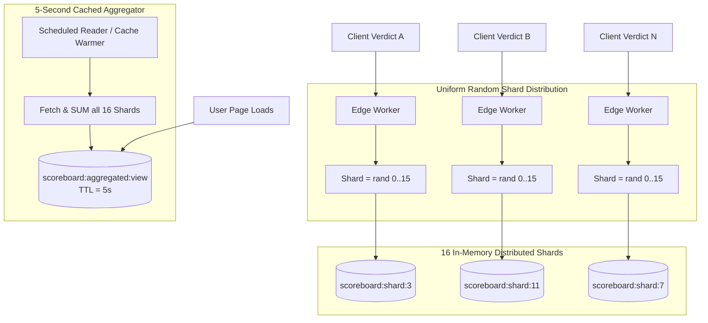

# Scaling, Performance & High Availability Architecture
**Project:** The Algorithm Knows Best  
**Document Version:** 1.0.0  
**Status:** Approved Scaling Strategy  

---

## 1. Scale Targets & Capacity Planning

| Metric | Phase 1 (Launch / Product Hunt) | Phase 2 (Growth / Wordle Cadence) | Phase 3 (Mass Viral Scale) |
| :--- | :--- | :--- | :--- |
| **Daily Active Users (DAU)** | 5,000 – 25,000 | 100,000 – 250,000 | 1,000,000+ |
| **Peak Requests / Sec (RPS)** | 150 RPS | 1,500 RPS | 12,000+ RPS |
| **Global Tally Writes / Sec** | 30 writes/s | 300 writes/s | 3,000+ writes/s |
| **Average Global Latency** | < 120 ms | < 80 ms | < 45 ms |
| **Target Infrastructure Cost** | ~$0 – $20/month (Free Tiers) | ~$50 – $150/month | ~$400 – $900/month |

---

## 2. Distributed Counter Sharding Strategy

The most compute-critical write operation in the system is the **Global Scoreboard** (*"Algorithm Right vs. Human Taste Right vs. Disputed"*). When an influencer shares the game or it hits the top of Reddit/HackerNews, thousands of users submit verdicts at the exact same second.

### 2.1 The Problem
A single Redis hash key `global:scoreboard` receiving 5,000+ atomic `HINCRBY` commands per second can cause single-thread CPU starvation, key-level lock contention, and latency spikes.

### 2.2 The Sharded Counter Architecture



### 2.3 Implementation (TypeScript)

```typescript
import { Redis } from "@upstash/redis";

export class ShardedScoreboardService {
  private static readonly NUM_SHARDS = 16;
  private static readonly CACHE_KEY = "scoreboard:aggregated:view";

  constructor(private redis: Redis) {}

  /**
   * Atomic, lock-free distributed increment across random shards
   */
  public async incrementVerdict(verdictType: "algo_right" | "user_right" | "disputed"): Promise<void> {
    const shardIndex = Math.floor(Math.random() * ShardedScoreboardService.NUM_SHARDS);
    const shardKey = `scoreboard:shard:${shardIndex}`;
    await this.redis.hincrby(shardKey, verdictType, 1);
  }

  /**
   * Reads aggregated total with 5-second TTL cache for massive read concurrency
   */
  public async getAggregatedScore(): Promise<{ algo: number; human: number; disputed: number }> {
    // 1. Check cached aggregate
    const cached = await this.redis.get<{ algo: number; human: number; disputed: number }>(
      ShardedScoreboardService.CACHE_KEY
    );
    if (cached) return cached;

    // 2. Aggregate across all 16 shards
    const pipeline = this.redis.pipeline();
    for (let i = 0; i < ShardedScoreboardService.NUM_SHARDS; i++) {
      pipeline.hgetall(`scoreboard:shard:${i}`);
    }
    const shardResults = await pipeline.exec();

    let algo = 0, human = 0, disputed = 0;
    for (const shard of shardResults) {
      if (shard && typeof shard === "object") {
        algo += parseInt((shard as any).algo_right || "0", 10);
        human += parseInt((shard as any).user_right || "0", 10);
        disputed += parseInt((shard as any).disputed || "0", 10);
      }
    }

    const aggregated = { algo, human, disputed };

    // 3. Cache aggregate with 5-second expiration
    await this.redis.set(ShardedScoreboardService.CACHE_KEY, aggregated, { ex: 5 });
    return aggregated;
  }
}
```

---

## 3. Edge Caching & Static Asset Architecture

To achieve sub-50ms TTFB across all geographic regions:

```
[ User Browser ]
       │
       ▼ (Anycast DNS)
[ Cloudflare Global Edge Network (300+ Cities) ]
       │
       ├─── Static Assets (JS, CSS, SVGs, Fonts)
       │    └── Cache-Control: public, max-age=31536000, immutable
       │
       ├─── Daily Question Set (/api/daily)
       │    └── Cache-Control: public, s-maxage=3600, stale-while-revalidate=86400
       │
       ├─── Dynamic OG Card Images (/api/og/*)
       │    └── Cache-Control: public, s-maxage=86400, immutable
       │
       └─── Verdict Submission (/api/verdict)
            └── Cache-Control: no-store, private (Routed to closest Edge Worker)
```

---

## 4. Client-Side Offline Resilience & PWA

The application implements a Progressive Web App (PWA) architecture with ServiceWorker caching:

1. **Precached App Shell:**
   - The HTML shell, CSS tokens, and sound effects are stored in CacheStorage during initial visit.
2. **Offline Fallback Engine:**
   - If the user is on an airplane or subway without signal:
     - The client executes the pure TypeScript `AntiRecommendationEngine` using an embedded fallback pool of 30 assignments.
     - Verdicts are staged in browser `IndexedDB`.
     - A background sync task dispatches the staged verdict once connectivity resumes.

---

## 5. Performance Budgets & Core Web Vitals Targets

Strict performance budgets are enforced in the CI/CD pipeline via Lighthouse CI:

```json
{
  "ci": {
    "assert": {
      "assertions": {
        "first-contentful-paint": ["error", { "maxNumericValue": 800 }],
        "largest-contentful-paint": ["error", { "maxNumericValue": 1200 }],
        "interactive": ["error", { "maxNumericValue": 1000 }],
        "cumulative-layout-shift": ["error", { "maxNumericValue": 0.02 }],
        "total-blocking-time": ["error", { "maxNumericValue": 50 }],
        "categories:performance": ["error", { "minScore": 0.98 }],
        "categories:accessibility": ["error", { "minScore": 1.00 }]
      }
    }
  }
}
```

### Bundle Size Budget:
- Total initial JavaScript: **< 65 KB** (gzipped / brotli).
- Total CSS: **< 12 KB** (gzipped).
- Zero external client component library dependencies (no massive UI component bloat).
