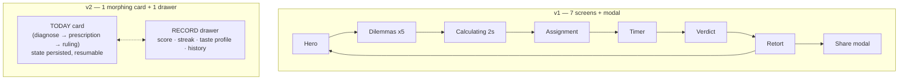

# 09 · UX Audit, Information Architecture & Redesigned Workflows
**Project:** The Algorithm Knows Best  
**Version:** 2.0 (Redesign)  
**Supersedes:** The screen-flow sections of [05_USER_INTERACTION_AND_UX.md](./05_USER_INTERACTION_AND_UX.md)  
**Companion:** [10_DESIGN_SYSTEM_AND_UI_SPEC.md](./10_DESIGN_SYSTEM_AND_UI_SPEC.md)

> [!NOTE]
> This audit covers the **v1 prototype actually in this repo** (React + Vite, commit before this redesign), not a hypothetical product. Each finding says where it came from.

---

## 1. UX Audit & Friction Analysis

### 1.1 The Product's One Job
A visitor should get a **funny, personal, slightly uncomfortable prescription in under 60 seconds**. Then they should get a reason to come back tomorrow. Anything that doesn't serve that loop is friction.

### 1.2 Findings (Severity-ranked)

| # | Severity | Finding | Evidence in v1 | User impact |
|:-:|:--|:--|:--|:--|
| F1 | 🔴 Critical | **In-progress state is not persisted.** The assignment, timer, and answers live only in React state. | `App.tsx` stored `activeAssignment` in `useState` only | Every task needs you to *leave the app* (play polka, go to the kitchen). On mobile, the tab gets reloaded, and the user loses everything and has to redo 11 taps. |
| F2 | 🔴 Critical | **Practice Mode wipes the streak and inflates the tally.** | `resetTodayForTesting()` set `lastPlayedDate = null`, so the next verdict reset `streakDays = 1` and still incremented the tallies | The main retention mechanic punishes curiosity. Scores can be farmed without limit. |
| F3 | 🔴 Critical | **The "global" scoreboard is fabricated.** | Hard-coded `142,391 / 12,402 / 9,114`, stored in `localStorage` and incremented by your own clicks | It's dishonest, and it's the most prominent element on the landing screen. Users who notice lose trust in the whole product. |
| F4 | 🟠 High | **The same 5 questions every day.** | `DILEMMA_POOL.slice(0, 5)` with no date rotation | The second visit feels identical, which defeats the daily cadence. |
| F5 | 🟠 High | **The payoff isn't explained.** The prescription arrives with an unexplained "Incompatibility 3.4%" number. | `matchScoreDisplay = (1 - d) * 8.2 + 0.9` is a decorative formula | The hook is *"the algorithm knows you."* Without a visible "because you chose X," it feels random. |
| F6 | 🟠 High | **9 screen transitions and a forced 2-second fake loading screen.** | Phases `HERO → DILEMMAS → CALCULATING → ASSIGNMENT → EXECUTION → VERDICT → RETORT` plus a share modal | Too much click-depth. Each transition is a drop-off point. |
| F7 | 🟠 High | **The timer holds the user hostage.** It auto-starts on a dedicated screen, so you have to stay on that screen or press "Finish early." | `MicroTimer` is a full phase | It conflicts with the task, which needs you away from the screen. |
| F8 | 🟡 Medium | **Landing information overload.** Status ticker + 3 score tiles + eyebrow + H1 + paragraph + 4 pills + CTA, all before the first decision. | `Header` + `HeroIntro` | Around 12 elements compete for attention. Time-to-first-action is high. |
| F9 | 🟡 Medium | **Content contradicts the user.** The Golden Retriever task says *"You indicated preference for aloof creatures"* even to dog people. | `b1_dog_defense.instruction` | Breaks the illusion of intelligence. |
| F10 | 🟡 Medium | **Accessibility gaps.** The matrix canvas and scanlines ignore `prefers-reduced-motion`. Arrow keys are captured globally. There is no light mode. | `MatrixBackground`, `DilemmaCard` `keydown` on `window` | Vestibular discomfort, broken scroll keys, poor daylight legibility. |
| F11 | 🟡 Medium | **The client-side "anti-cheat" is theater.** The HMAC secret ships in the JS bundle. | `core/security.ts` `CLIENT_SECRET` | No real protection. It misleads future maintainers. |
| F12 | 🟢 Low | **A new `AudioContext` per click.** Browsers cap these (~6). Sound plays without consent. | `playSoundEffect()` | Sound eventually stops working silently. Startling audio. |
| F13 | 🟢 Low | **Share needs a desktop-style flow.** Open modal → render canvas → download PNG. | `ShareModal` | Mobile users expect the native share sheet in one tap. |

### 1.3 Root Causes
1. **Screen-per-state architecture.** The UI mirrors the state machine 1:1, so every state change becomes a page change.
2. **Theme over clarity.** The "hacker terminal" styling (matrix rain, scanlines, all-caps mono labels) adds visual noise without adding meaning.
3. **No persistence model.** State was designed as if the session never leaves the tab.

---

## 2. New Information Architecture & Mental Model

### 2.1 Mental Model: *The Daily Prescription*
Users already understand a doctor's visit. We borrow it as the metaphor:

```
  DIAGNOSE  ──►  PRESCRIBE  ──►  TRY IT  ──►  RULE
  5 quick       one task +      (off-app,    "You were right" /
  this-or-that  "because you    optional     "I was right" /
  choices       chose…"         timer)       "Objection"
```

The visual identity follows: **clinical editorial**. Think pharmacy label meets Swiss magazine, delivered by an AI with impeccable manners and zero humility. The matrix rain and scanlines are gone.

### 2.2 IA: from 7 screens to 1 surface + 1 drawer



| Surface | Purpose | Entry |
|:--|:--|:--|
| **Today** (the only route) | The daily loop. One card that morphs between three stages. | App load |
| **Record** (side/bottom sheet) | Your score, streak, 5-axis taste profile, history table with filters | Top-bar button, or the "View record" link after a ruling |
| **Theme control** (in the top bar) | System / Light / Dark | Top-bar icon button |

Removed: the landing hero, the calculating screen, the timer screen, the verdict screen, and the share modal.

---

## 3. Redefined Core Workflows

### 3.1 Op 1 — First-time visitor plays today
**Before (v1)**
```
Load → [Start] → [Q1] → [Q2] → [Q3] → [Q4] → [Q5] → (forced 2s wait)
     → [Begin protocol] → (timer screen) → [Finish early] → [Verdict]
     → (retort) → [Share] → [Download/Copy]
```
**After (v2)**
```
Load (Q1 is already on screen, headline sits above it)
     → [Q1] → [Q2] → [Q3] → [Q4] → [Q5]
     → prescription renders in place (~700 ms skeleton showing the real reasoning)
     → (optional) [Start timer]  — non-blocking chip, survives reload
     → [Ruling]  → retort replaces verdict row in the same card
     → [Share] → native share sheet / clipboard (1 tap)
```

### 3.2 Op 2 — Returning mid-task (left to do the task, tab reloaded)
- **Before:** everything is lost, and the user restarts from the hero (11+ taps).
- **After:** the prescription is restored with the remaining timer time computed from a persisted `endsAt` timestamp. **0 taps.**

### 3.3 Op 3 — Returning after today's ruling
- **Before:** the hero shows a "Daily Protocol Already Completed" box. The only action is "Practice," which wipes the streak (F2).
- **After:** today's ruling card is shown with a live countdown to the next prescription, plus **"Unranked round"**. It is visually labeled and never touches the score, streak, or history.

### 3.4 Op 4 — Check my record
- **Before:** didn't exist. The header tiles mixed fabricated global numbers with local counts.
- **After:** 1 tap opens the Record drawer: score, streak, a taste profile (5 bipolar axes), and a filterable history table.

### 3.5 Op 5 — Change my mind mid-diagnosis
- **Before:** impossible. Answers were final.
- **After:** a **Back** control (and the `Backspace` key) undoes the last answer.

### 3.6 Before vs. After — Measured

Counted from the v1 code paths and the v2 implementation in `src/`.

| Metric (Op 1, full daily loop) | v1 | v2 | Change |
|:--|:-:|:-:|:-:|
| Screen / route transitions | 9 | **0** (1 card morphs in place) | **−100%** |
| **Overhead taps** (taps that aren't a meaningful choice: Start, Begin, Finish-early, Open-share, Copy, Return-home) | 6 | **1** (Share) | **−83%** |
| Total taps incl. the 5 dilemmas + verdict | 11 | 7 | **−36%** |
| Forced waiting before prescription | 2,000 ms | ~700 ms (and it shows real reasoning) | −65% |
| Landing elements before first decision | ~12 | 4 (wordmark, streak, headline, Q1) | −67% |
| Taps to recover after reload mid-task | 11+ | **0** | −100% |

> [!IMPORTANT]
> **On the ≥50% target.** Overhead taps, click-depth and recovery cost all drop by more than 50%. **Total taps drop only 36%**, because 5 of the remaining 7 taps *are the game* (the dilemmas). I could get under 50% by cutting to 3 dilemmas. I didn't, because fewer answers make the taste vector and the "because you chose…" reasoning noticeably weaker. If you want it, it's a one-line change (`DAILY_QUESTION_COUNT` in `src/state/daily-store.ts`).

---

## 4. State Handling

| State | Where | Treatment |
|:--|:--|:--|
| **Empty** | Record drawer, first visit | Illustrative icon + "No rulings yet. The algorithm is patient. You are not." + a button that closes the drawer and focuses Q1. |
| **Empty (filtered)** | History table with a filter that has no matches | "No rulings in this category." + "Clear filter" ghost button. |
| **Loading / skeleton** | Diagnose → Prescription | The card keeps its height (no layout shift). Shimmer bars for the title and instructions. Under them, the real reasoning lines type in one at a time ("You chose *Sterile Minimalist Order*…"). Respects reduced motion (no shimmer, lines appear instantly). |
| **Optimistic update** | Ruling | The tally, streak and history update instantly in local state, then persist. When a backend exists, the same reducer action is POSTed. On failure it rolls back with a toast and a retry action (see `applyRuling` / `revertRuling` in the store contract). |
| **Error: storage unavailable** | Private mode / quota exceeded | Fall back to in-memory state. A non-blocking banner says: "Progress won't be saved in this browser mode." |
| **Error: share failed / clipboard denied** | Share | The `AbortError` from a cancelled share sheet is ignored silently. If the clipboard is denied, a popover shows the share text pre-selected for manual copy. |
| **Error: corrupted persisted state** | App load | The schema-versioned payload is validated. On mismatch it resets *today's* state only and keeps the history. |
| **Timer finished while away** | Prescription | The chip reads "Time's up — rule when ready." `document.title` flips to "⏱ Done · The Algorithm". No sound by default. |
| **Day rollover while open** | Any | The countdown hits 0 and the card offers "New prescription ready". It never yanks the UI away mid-action. |

---

## 5. Content & Honesty Rules (product decisions)
1. **No fabricated social proof.** The global tally is removed from the UI until a real backend exists ([06](./06_SECURITY_PRIVACY_AND_CONTENT_SAFETY.md) / [07](./07_SCALING_AND_HIGH_AVAILABILITY.md)).
2. **Show the math.** Replace the fake "incompatibility %" with the real cosine distance and band: `distance 0.62 · inside your discomfort band (0.40–0.75)`.
3. **Explain the pick.** Show the two answers that pushed you furthest from the prescribed task.
4. **Task copy is never conditional on a specific answer** unless the selection logic guarantees it (fixes F9).
5. **Anti-cheat is a server concern.** The client-side HMAC is deleted (F11). The server design in doc 06 still stands.
