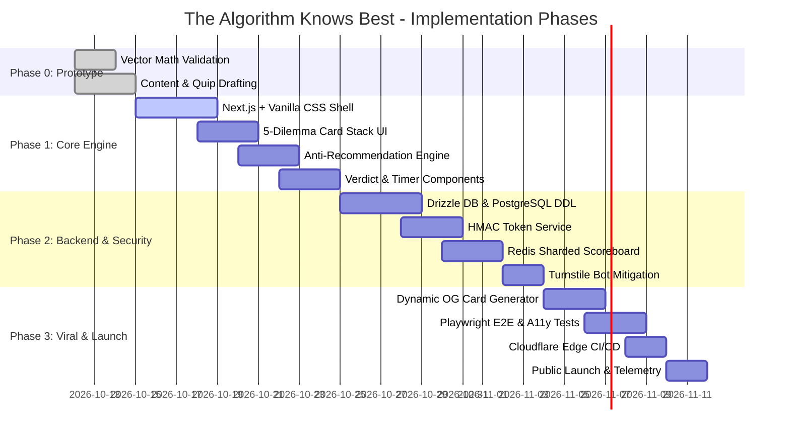

# Master Engineering & Architecture Documentation
**Project:** The Algorithm Knows Best  
**Repository:** `TheAlgorithmKnowsBest`  
**Status:** Approved Master Engineering Blueprint  

Welcome to the comprehensive engineering specification for **The Algorithm Knows Best**—a high-performance, asymmetrical daily web game designed to pit human intuition against a mathematically arrogant anti-recommendation algorithm.

---

## 📑 Architecture & Engineering Documentation Map

The engineering documentation has been organized into eight modular, deep-dive specifications in this `Docs/` directory:

| Document | Topic | Key Highlights |
| :--- | :--- | :--- |
| **[01. System Architecture Overview](file:///home/darling/Downloads/Project-Related/TheAlgorithmKnowsBest/Docs/01_ARCHITECTURE_OVERVIEW.md)** | High-Level Architecture & Tech Stack | C4 Context & Container Models, Tech Stack Matrix (Next.js, Edge, Drizzle, Redis), Subsystem breakdown. |
| **[02. UML & System Behavioral Models](file:///home/darling/Downloads/Project-Related/TheAlgorithmKnowsBest/Docs/02_UML_AND_SYSTEM_FLOWS.md)** | Formal Diagrams & Workflows | Domain Class Diagram, Sequence Diagrams (Daily Loop, Vector Engine, Verdict Submission, Dynamic OG), State Machine & Activity Flow. |
| **[03. Mathematical Algorithm Specification](file:///home/darling/Downloads/Project-Related/TheAlgorithmKnowsBest/Docs/03_MATHEMATICAL_ALGORITHM_SPEC.md)** | Anti-Recommendation Engine | 5D Vector Space, Cosine Distance formulation, Middle-band filtering (0.40–0.75 band), Learning Perturbation, TypeScript Reference Engine. |
| **[04. Database Architecture & Data Model](file:///home/darling/Downloads/Project-Related/TheAlgorithmKnowsBest/Docs/04_DATABASE_AND_DATA_MODEL.md)** | Persistence & Cache Design | PostgreSQL Production SQL DDL, Entity-Relationship Diagram (ERD), Redis Key Topology, Sharded Atomic Tally, 30-Assignment Seed Data. |
| **[05. User Interaction & UX Design System](file:///home/darling/Downloads/Project-Related/TheAlgorithmKnowsBest/Docs/05_USER_INTERACTION_AND_UX.md)** | UX, Design Tokens & Copy Bible | 8-screen state flow, Design Tokens (Neo-Brutalist Cyber Terminal), Sarcastic Personality Matrix (30+ quips), WCAG 2.1 AA Accessibility. |
| **[06. Security, Privacy & Content Safety](file:///home/darling/Downloads/Project-Related/TheAlgorithmKnowsBest/Docs/06_SECURITY_PRIVACY_AND_CONTENT_SAFETY.md)** | STRIDE & Cryptographic Integrity | HMAC-SHA256 Signed Verdict Claims, Anti-Replay Nonce Cache, Turnstile Bot Mitigation, Zero-PII GDPR/CCPA Design, Content Safety Quarantine. |
| **[07. Scaling & High Availability](file:///home/darling/Downloads/Project-Related/TheAlgorithmKnowsBest/Docs/07_SCALING_AND_HIGH_AVAILABILITY.md)** | 1K to 1M DAU Scaling Strategy | Distributed Redis Counter Sharding (16 shards), Global Edge Caching (sub-50ms TTFB), PWA Offline Fallback, Core Web Vitals Budgets. |
| **[08. Deployment, DevOps & CI/CD](file:///home/darling/Downloads/Project-Related/TheAlgorithmKnowsBest/Docs/08_DEPLOYMENT_DEVOPS_AND_CI_CD.md)** | Deployment Topologies & Automation | Dual Topology (Cloudflare Pages/Edge vs Hardened Docker Container), Multi-stage Dockerfile, Docker Compose, GitHub Actions Pipeline. |

---

## 🏛️ Architectural Decision Records (ADRs) Summary

| Decision ID | Context / Problem | Decision Made | Rationale |
| :--- | :--- | :--- | :--- |
| **ADR-001** | Recommendation Paradigm | **Anti-Recommendation** in the 40%–75% distance band rather than top similarity. | The humor and engagement stem from safe, provocative friction rather than cozy echo chambers. |
| **ADR-002** | User Onboarding & Auth | **Zero Authentication** (Persistent Anonymous UUID + LocalStorage). | Frictionless entry yields 10x higher conversion; zero barrier for a 3-minute casual daily game. |
| **ADR-003** | Leaderboard Integrity | **HMAC-SHA256 Token Issuance** on assignment generation with 15-minute TTL. | Prevents automated bots from manipulating the global tally with arbitrary POST requests. |
| **ADR-004** | Global Counter Concurrency | **16-Shard Distributed Counters** in Redis with 5-second aggregated caching. | Eliminates single-key contention during viral traffic spikes (supports 10,000+ RPS). |
| **ADR-005** | Offline Resilience | **Client-Side Pure TypeScript Math Engine** with embedded fallback pool. | Guarantees playability even when offline or during transient server partitions. |

---

## 🚀 Phased Implementation Roadmap

---

## 🔍 Verification & Definition of Done (DoD)

Before any code is promoted to production:
1. **Mathematical Accuracy:** Anti-recommendation distance calculations verified across 100 random taste vectors; 100% of selections strictly fall within the $0.40 \le \mathcal{D} \le 0.75$ band.
2. **Security Verification:** Automated tests confirm that unsigned or expired verdict submissions return HTTP 403/409 and do not increment counters.
3. **Performance Gate:** Lighthouse CI score $\ge 98$ across Performance, Accessibility, and Best Practices. Bundle size $< 80$ KB.
4. **Resilience:** The game completes end-to-end with the network set to "Offline" in Chrome DevTools.
